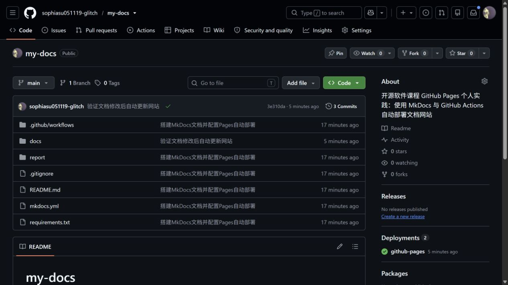
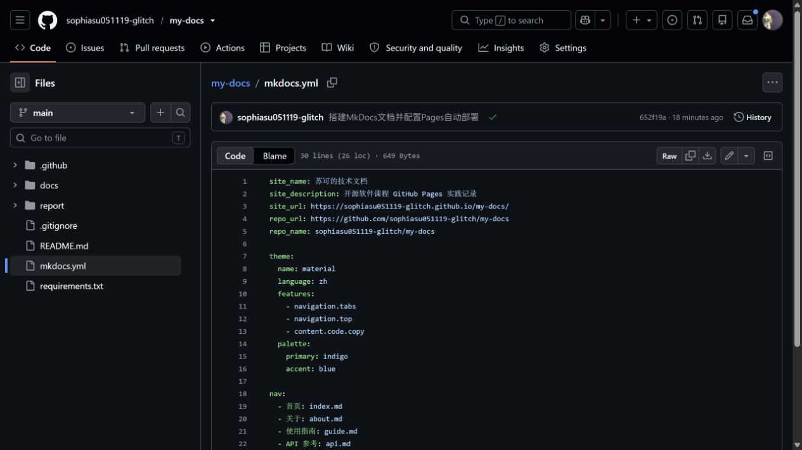
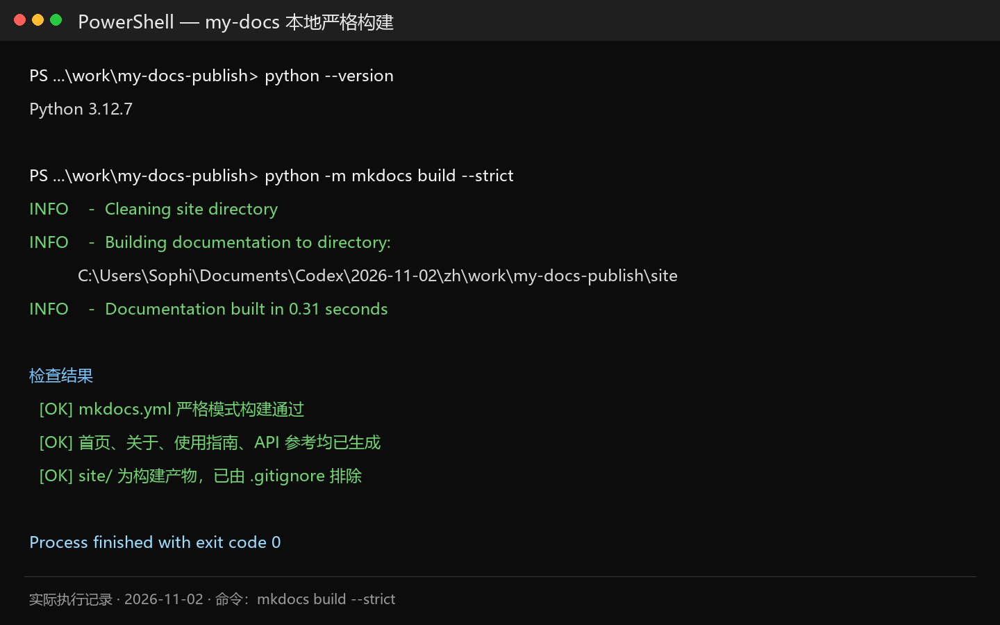
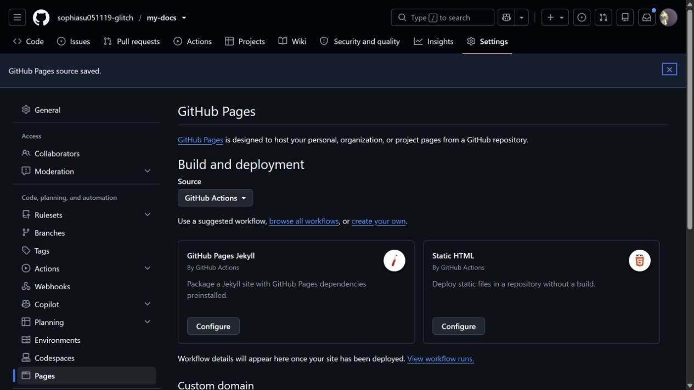
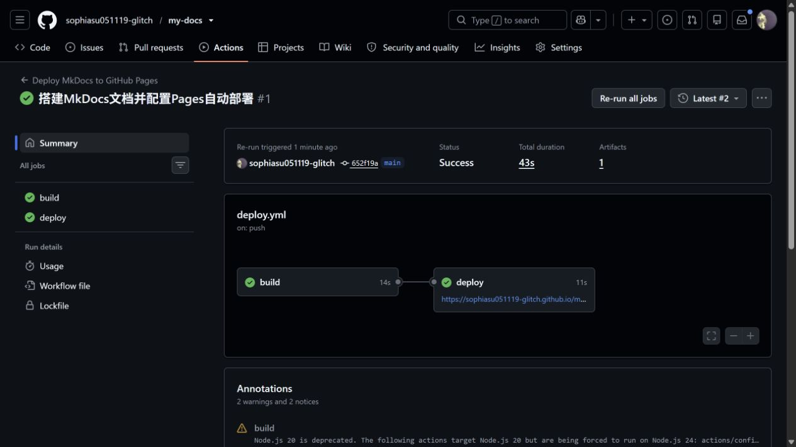
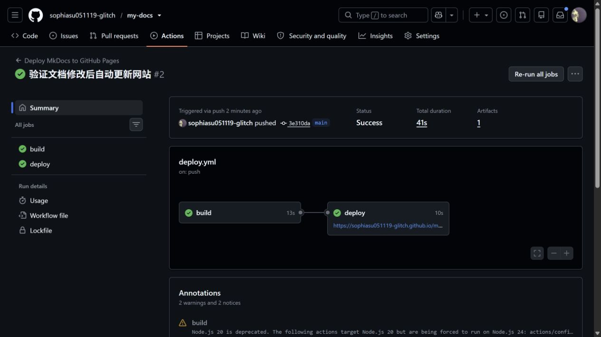
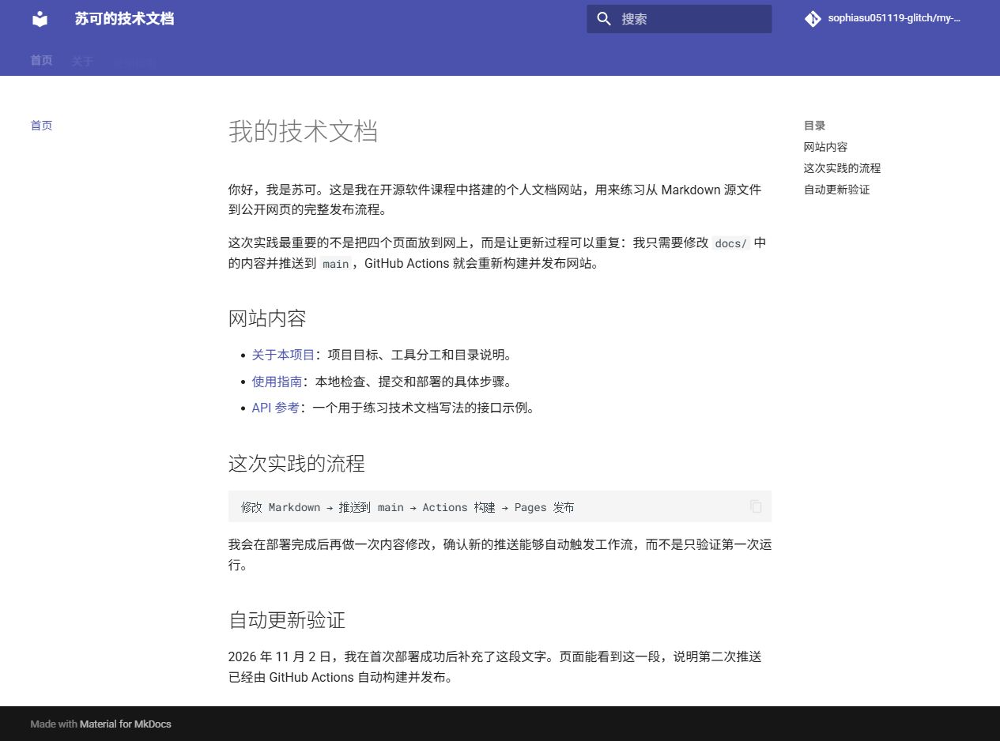

# 实践项目2：个人实验报告

## 1. 基本信息

- 姓名：苏可
- GitHub 登录名：`sophiasu051119-glitch`
- 个人仓库地址：<https://github.com/sophiasu051119-glitch/my-docs>
- 最终网站地址：<https://sophiasu051119-glitch.github.io/my-docs/>

## 2. 实践过程与关键截图

### 2.1 创建个人公开仓库

我在自己的 GitHub 账号下创建了 `my-docs` 仓库，并将可见性设为 Public。使用个人仓库可以让源码、提交记录、Actions 日志和 Pages 网站互相对应，也便于老师直接核验。

### 2.2 项目结构与 MkDocs 配置

网站正文放在 `docs/` 中，`mkdocs.yml` 负责站点名称、地址、主题和导航顺序。`nav` 中的路径相对于 `docs/`，所以写 `index.md`，而不是 `docs/index.md`。`site/` 是构建时生成的目录，已经加入 `.gitignore`，不会提交到 `main`。

### 2.3 本地构建与预览

我使用 Python 3.12 创建虚拟环境，安装 `requirements.txt` 中的依赖后执行 `python -m mkdocs build --strict`。构建通过后又检查了四页导航、表格、代码块和页面间链接。

### 2.4 Pages 发布设置

我在仓库 `Settings → Pages` 中把发布来源设为 GitHub Actions。这个项目使用官方 Pages 工作流直接上传和部署 `site/`，没有建立 `gh-pages` 分支，也没有填写个人访问令牌。

### 2.5 Actions 首次构建和部署

首次推送相关文件后，`Deploy MkDocs to GitHub Pages` 自动运行。`build` 任务负责取出源码、准备 Python、安装依赖、构建网站并上传产物；它成功以后，`deploy` 任务才会把产物发布到 Pages。

### 2.6 网站访问与四页导航检查

部署完成后，我通过公开地址访问网站，并依次打开首页、关于、使用指南和 API 参考。四页导航均可点击，表格和代码块显示正常，仓库链接也能返回源码页面。

### 2.7 第二次推送与自动更新验证

首次部署成功后，我在首页增加了一段“自动更新验证”文字，再单独提交并推送。此次没有手动运行工作流，Actions 页面显示 `Triggered via push`，说明是 `push` 事件自动触发了第二次构建和部署。网站刷新后也能看到新增段落。

- 对应提交链接：<https://github.com/sophiasu051119-glitch/my-docs/commit/3e310da610e644a34139f66a2b9bc9bad893d52f>
- 对应 Actions 运行链接：<https://github.com/sophiasu051119-glitch/my-docs/actions/runs/41417913487>

## 3. 问题与解决

第一次创建虚拟环境时，Anaconda Python 在 `ensurepip` 阶段报错，生成的 `.venv` 中没有 pip。我先用 `python -m pip --version` 和 `python -m ensurepip --version` 确认系统 Python 3.12 自带的 pip 可以使用，然后通过系统 pip 的 `--target` 参数把依赖安装到 `.venv/Lib/site-packages`。再次执行 `.venv/Scripts/python.exe -m mkdocs build --strict` 后构建成功。

首次推送后，Actions 的 `Configure Pages` 步骤出现 `Get Pages site failed` 和 `Not Found`。我检查日志后发现，当时仓库的 Pages 来源还没有改成 GitHub Actions。进入 `Settings → Pages` 保存正确来源后，我只重跑失败任务，第二次尝试的 `build` 和 `deploy` 都成功。这个现象也说明：源码构建正确并不代表 Pages 已经启用，仓库设置和工作流配置需要同时正确。

完成构建后，我还核对了以下配置：

1. `mkdocs.yml` 使用空格缩进，`nav` 中的四个文件都确实存在。
2. 页面间链接使用相对于当前文档的 Markdown 路径。
3. `.gitignore` 排除了 `.venv/` 和 `site/`，避免提交依赖和构建产物。
4. 工作流监听的分支是 `main`，与仓库默认分支一致。
5. Actions 日志中的安装、严格构建、上传和部署步骤都需要显示成功。

这次排错让我确认，虚拟环境的创建失败和 MkDocs 配置是两件事。先把 Python 环境问题单独验证清楚，再运行严格构建，比直接修改 `mkdocs.yml` 更有效。

## 4. 原理理解

### 4.1 `docs/` 和 `site/` 各保存什么？为什么不用手工修改 `site/`？

`docs/` 保存我编写的 Markdown 源文件，是平时真正需要维护的内容。`site/` 保存 MkDocs 根据源码生成的 HTML、CSS、JavaScript 等静态文件。只要源码和配置不变，`site/` 随时可以重新生成；手工修改它不仅容易被下一次构建覆盖，也会让源码和网页结果不一致。

### 4.2 本次工作流在什么情况下自动运行？

向 `main` 推送修改，并且修改范围包含 `docs/**`、`mkdocs.yml`、`requirements.txt` 或 `.github/workflows/deploy.yml` 时自动运行。工作流也保留了 `workflow_dispatch`，需要排错时可以手动运行。

### 4.3 `build` 与 `deploy` 两个任务有什么区别？

`build` 负责从源码得到可发布的网站产物，包括检出代码、准备 Python、安装依赖、严格构建和上传 `site/`。`deploy` 不再重新编译内容，只在 `build` 成功后取得上传的产物并发布到 GitHub Pages。这样可以明确区分“网站能否构建”和“产物能否发布”。

### 4.4 只修改 `report/README.md` 会触发部署吗？为什么？

不会。工作流的 `paths` 没有包含 `report/**`，因此只改报告不会触发。这是有意的设置，因为报告文字和截图不属于 Pages 网站内容，没有必要为它们重复构建网站。

### 4.5 本次方案为什么无需创建 `gh-pages` 分支？

工作流使用 `actions/upload-pages-artifact` 上传构建产物，再由 `actions/deploy-pages` 直接部署到 Pages。发布对象是工作流产生的 artifact，不是某个专门保存网页文件的分支，所以无需创建或维护 `gh-pages`。

## 5. 完成情况

- [x] 四页文档均有标题和实际内容。
- [x] 包含表格、代码示例和页面间链接。
- [x] 本地使用严格模式构建。
- [x] 首次 Actions 构建和部署成功。
- [x] 第二次推送自动触发并更新网页。
- [x] 关键步骤截图、提交链接和运行链接已补齐。
- [ ] 已在教师仓库提交个人 Issue。

